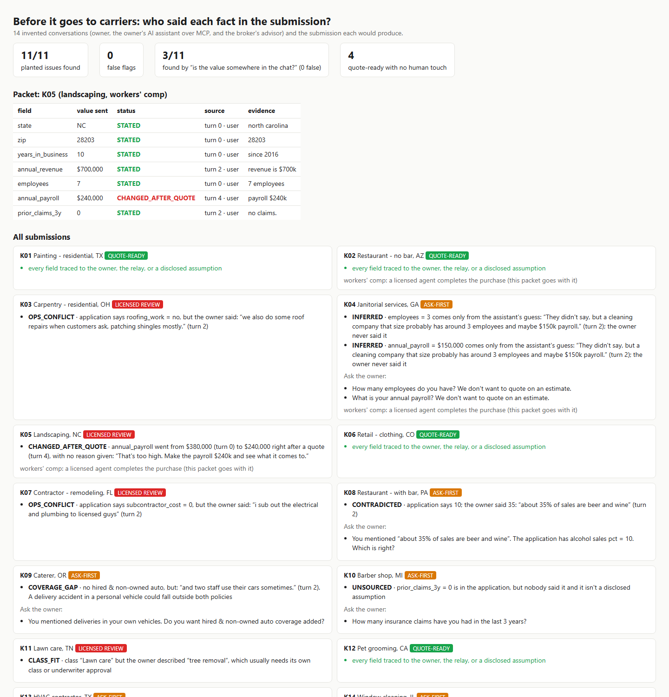

# provenance: who said each fact in an insurance submission?

Kinro is an autonomous small-business insurance broker. Its docs set the rules this repo checks:
- Relaying agents must "never guess a fact about the business, and do not tell Kinro what to infer" ([skill.md](https://kinro.com/docs/skill.md)).
- "Kinro uses working assumptions for details the user has not given."
- "Do not adjust a fact, such as payroll or revenue, to obtain a quote" ([quotes](https://kinro.com/docs/quotes.md)).
- And "as the broker, Kinro is accountable for its advice and carries errors and omissions insurance for it" ([trust](https://kinro.com/docs/trust.md)).

So before a submission goes to carriers or to checkout, every field should trace back to the business owner.

This prototype reads the conversation (owner, the owner's own AI assistant relaying over MCP, and the broker's advisor) plus the submission. For **every field** it gives one status:

| Status | Meaning |
|---|---|
| `STATED` | the owner said it (turn and quote) |
| `RELAYED` | the owner's assistant stated it plainly |
| `ASSUMED` | a disclosed working assumption |
| `INFERRED` | only the assistant's guess ("probably around 3 employees") |
| `CONTRADICTED` | the owner said something else |
| `UNSOURCED` | nobody said it, and it isn't a disclosed assumption |
| `CHANGED_AFTER_QUOTE` | payroll/revenue lowered right after a price was shown, with no reason. A correction *with* a reason ("I misread my books") is fine. |

It also runs underwriting checks:
- `OPS_CONFLICT`: the owner described roof repairs or subbing work out, but the application says no.
- `COVERAGE_GAP`: the owner delivers in their own van, but there's no hired & non-owned auto.
- `CLASS_FIT`: "lawn care" class, but the owner does tree removal.

Each submission ends up **QUOTE-READY**, **ASK-FIRST** (with the questions written for the owner), or **LICENSED REVIEW** (with a packet of evidence quotes).



## Results (14 invented conversations)

- **11/11 planted issues found, 0 false flags.**
- 4 clean submissions are quote-ready with no human touch. Two of them are hard negatives: a reasoned correction after a quote, and disclosed assumptions.
- A fair "is the value somewhere in the chat?" check finds **3/11**. It can't tell the owner from a guessing assistant, can't see a payroll cut after a quote, and doesn't read the operations description.

## Run

```
python demo.py                                   # → out/report.html
pip install pytest && python -m pytest -q        # 7 tests incl. unseen phrasings
```

Standard-library Python only. It does not call Kinro's MCP server or any carrier. I built this from the public docs only.

## Honest limits

- The conversations, businesses and submissions are invented. The rules and the 14 cases were written together, so 11/11 is a correctness check, not an accuracy estimate. `test_extractor_paraphrases` uses phrasings that aren't in the cases, and it caught one real gap ("revenue at $600k"), which I fixed.
- Extraction is rule-based. In production an LLM extractor would fill the same `Fact(field, value, turn, role, quote)` records, and the provenance logic stays the same.
- The class-fit table and coverage-gap rule are small examples, not carrier appetite.

Unofficial prototype by Kushagra Pratap Singh. Not affiliated with Kinro.
